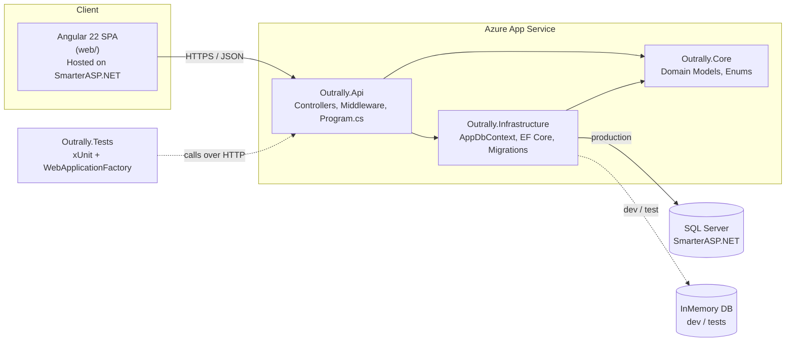

# Outrally

Outrally is a web app that makes it easier to organize outdoor activities like hikes, trips and group events, and keeps safety information available offline.

It's built first for hiking groups in **El Paso, TX**, but it's **multi-tenant**: many groups can use the same deployment, and each group sees only its own data.

---

## Why Outrally

Hiking groups usually organize through group chats, spreadsheets and word of mouth. That works until it doesn't:

- **Details get lost.** The trailhead, start time and gear list end up buried under 200 chat messages.
- **Headcount is guesswork.** Nobody knows who's actually coming, and some trails or permits have participant limits.
- **There's no signal on the trail.** The place you most need safety information (emergency contacts, route notes, bail-out points) is also the place you can't load a web page.

Outrally gives each activity one source of truth: what, when, where and who. Safety information is built to work offline. The app is also a teaching project, so every phase is documented here for junior developers to follow.

---

## Architecture



**Key rule:** dependencies only point **inward, toward `Core`**. `Core` doesn't know the database, the web framework or the tests exist.

---

## Solution structure

```
outrally/
├── Outrally.Core/           # Domain models and enums. No dependencies on other projects.
├── Outrally.Infrastructure/ # AppDbContext, EF Core, migrations. Depends on Core.
├── Outrally.Api/            # ASP.NET Core controllers, middleware, Program.cs. Depends on Core + Infrastructure.
├── Outrally.Tests/          # xUnit integration tests using WebApplicationFactory. Depends on Core + Api.
└── web/                     # Angular 22 SPA
```

### Why each project exists

| Project | What it holds | Why it's separate |
|---|---|---|
| **Outrally.Core** | Domain models (`Activity`) and enums (`ActivityStatus`) | This is the heart of the app: the business concepts. It depends on **nothing**, so it never breaks because of a database or framework change. |
| **Outrally.Infrastructure** | `AppDbContext`, EF Core configuration, migrations | It's the only project that knows how to talk to the database. If we ever switch databases, only this project changes. |
| **Outrally.Api** | Controllers, middleware, `Program.cs` (DI, CORS, Swagger) | A **thin** HTTP layer. It receives requests, delegates the work and returns responses. Business rules don't belong here. |
| **Outrally.Tests** | xUnit integration tests | Tests the **full HTTP pipeline** (routing, controllers, serialization, DbContext) with an in-memory database, so tests are fast and need no SQL Server. |
| **web/** | Angular SPA | The user interface. It's deployed separately from the API and talks to it only through HTTP. |

### Why layered?

- **Testable:** `Core` has no dependencies, so it's easy to test. The API can run against an in-memory database in tests.
- **Replaceable:** you can change one layer (for example, the database) without rewriting the others.
- **Easy to navigate:** once you know the rule, you know where new code goes. A new entity goes in `Core`, a new table mapping in `Infrastructure`, a new endpoint in `Api`.

> **Rule of thumb:** if you find yourself adding a `using Microsoft.EntityFrameworkCore;` inside `Outrally.Core`, stop. That code belongs in `Infrastructure`.

---

## Tech stack

| Area | Technology |
|---|---|
| Backend | ASP.NET Core 9 Web API (C#) |
| Frontend | Angular 22 SPA (TypeScript, SCSS) |
| Database | SQL Server (hosted on SmarterASP.NET) |
| ORM | Entity Framework Core 9, code-first |
| Dev/Test database | EF Core InMemory provider |
| Testing | xUnit, Moq, FluentAssertions, `WebApplicationFactory` |
| API docs | Swagger / OpenAPI |
| CI/CD | GitHub Actions |
| API hosting | Azure App Service |
| Frontend hosting | SmarterASP.NET |

---

## Running locally

### Prerequisites

Install these first:

- [.NET 9 SDK](https://dotnet.microsoft.com/download/dotnet/9.0). Check with `dotnet --version`.
- [Node.js](https://nodejs.org/), in a version supported by Angular 22. Check the [Angular version compatibility guide](https://angular.dev/reference/versions) and `node --version`.
- Angular CLI: `npm install -g @angular/cli`
- Git
- *(Optional)* An editor: Visual Studio 2022, JetBrains Rider or VS Code with the C# Dev Kit
- *(Optional)* SQL Server. You only need it to test against a real database. Local development uses the InMemory database by default.

### 1. Clone the repo

```bash
git clone <repo-url> outrally
cd outrally
```

### 2. Run the API

```bash
dotnet restore
dotnet build
dotnet run --project Outrally.Api
```

The console prints the URL the API is listening on (from `Outrally.Api/Properties/launchSettings.json`). Then:

- Open **Swagger UI** at `https://localhost:<port>/swagger` to explore and try the endpoints.
- Try the endpoint directly at `https://localhost:<port>/api/activities`. Expect `[]` on a fresh InMemory database.

#### InMemory vs SQL Server

`Program.cs` chooses the database provider at startup:

- **Development / tests**: EF Core **InMemory**. There's nothing to install, and data resets every time the app restarts.
- **Production**: **SQL Server**, using the connection string from configuration.

To run locally against SQL Server, set the connection string with [user secrets](https://learn.microsoft.com/aspnet/core/security/app-secrets) so it never gets committed:

```bash
cd Outrally.Api
dotnet user-secrets init
dotnet user-secrets set "ConnectionStrings:DefaultConnection" "Server=...;Database=Outrally;..."
```

> Check `Program.cs` for the exact setting that switches providers and the connection string name it reads, and update this section if they differ.

> ⚠️ **Never commit connection strings or passwords.** Use user secrets locally and App Service configuration in Azure.

### 3. Run the Angular app

In a second terminal:

```bash
cd web
npm install
ng serve
```

Open `http://localhost:4200`. The API's CORS policy must allow this origin. It's configured in `Program.cs`.

---

## Running tests

From the repository root:

```bash
dotnet test
```

Useful variations:

```bash
# More detailed output
dotnet test --logger "console;verbosity=detailed"

# Run a single test by name
dotnet test --filter "FullyQualifiedName~GetActivities_ReturnsOk"
```

### How the tests work

The tests in `Outrally.Tests` are **integration tests**. They don't call controller methods directly. Instead:

1. `WebApplicationFactory<Program>` starts the real API **in memory**, with no network and no deployed server.
2. The test replaces the database with the **InMemory** provider, so each test starts from a known state.
3. The test sends a real HTTP request through an `HttpClient` and checks the response with **FluentAssertions**.

So one test exercises routing, the controller, JSON serialization and EF Core together, which is very close to what a real client does.

Frontend tests (Angular) run from `web/`:

```bash
cd web
ng test
```

---

## Phase log

Each phase is a small, working, tested slice of the app. When you finish a phase, update this section.

### ✅ Phase 1: Foundation and first endpoint (complete)

**Goal:** prove the architecture end to end, from HTTP request to database and back, with tests and CI in place from day 1.

**What was built:**

- **`Activity` model** (`Outrally.Core`)
  | Property | Purpose |
  |---|---|
  | `Id` | Primary key |
  | `Title` | Short name, e.g. "Ron Coleman Trail" |
  | `Description` | Details, gear and notes |
  | `ScheduledDate` | When it happens |
  | `Location` | Trailhead or meeting point |
  | `MaxParticipants` | Capacity limit |
  | `Status` | See `ActivityStatus` |
  | `CreatedAt` | When the record was created |
- **`ActivityStatus` enum**: `Upcoming`, `InProgress`, `Completed`, `Cancelled`
- **`AppDbContext`** (`Outrally.Infrastructure`) with an `Activities` DbSet
- **`Program.cs`** with CORS, Swagger and the InMemory/SQL Server switch
- **`GET /api/activities`**, which returns the list of activities
- **Two TDD tests**, each written first and watched fail (Red), then made to pass (Green):
  - `GetActivities_ReturnsOk`: the endpoint exists and returns HTTP 200
  - `GetActivities_ReturnsEmptyList_WhenNoActivities`: an empty database returns `[]`, not `null` and not an error
- **GitHub Actions** pipeline that builds and runs tests

**Lessons for juniors:**

- The first test failed because the endpoint didn't exist yet. **That's the point.** A test you've never seen fail might not be testing anything.
- Test the "empty" case early. Returning `null` instead of `[]` is a common bug that breaks front-ends.

### ⬜ Phase 2: _TBD_

> Placeholder. Describe the goal, what was built, the tests added and lessons learned.

### ⬜ Phase 3: _TBD_

> Placeholder.

### ⬜ Phase 4: _TBD_

> Placeholder.

---

## Troubleshooting notes

Short notes on things that tripped us up. If you lose more than 15 minutes to a problem, add it here.

### Angular 22: root component files are `app.ts` / `app.html`, not `app.component.*`

**Symptom:** tutorials, Stack Overflow answers and older docs tell you to edit `app.component.ts` and `app.component.html`, but those files don't exist in `web/src/app/`.

**Cause:** Angular 22 changed the default naming convention for the root component.

| Older Angular | Angular 22 |
|---|---|
| `app.component.ts` | `app.ts` |
| `app.component.html` | `app.html` |
| class `AppComponent` | class `App` |

**Fix:** to add a new component to the root, edit `app.ts` (add it to the `imports` array) and `app.html` (use its selector). The bootstrapped class is `App`, so anything that references the root component by name should use `App`, not `AppComponent`.

---

## Contributing and development approach

### 1. Test-driven development (TDD)

Every feature follows **Red → Green → Refactor**:

1. **Red:** write a test for the behavior you want. Run it and **watch it fail**.
2. **Green:** write the **minimum** code to make it pass. Don't add extras.
3. **Refactor:** clean up names, remove duplication and simplify, keeping all tests green.

Name tests as `Method_ExpectedResult_WhenCondition`, for example `GetActivities_ReturnsEmptyList_WhenNoActivities`. Someone should be able to read the test name and know what broke.

### 2. CI/CD from day 1

- Every push and pull request runs the **GitHub Actions** pipeline: restore, build and test.
- **A red pipeline is everyone's top priority.** Don't merge on red.
- Run `dotnet test` locally before you push. It's faster than waiting for CI to tell you.

### 3. Respect the layers

| If you're adding… | It goes in… |
|---|---|
| A new entity or enum | `Outrally.Core` |
| A table mapping, migration or query | `Outrally.Infrastructure` |
| A new endpoint or middleware | `Outrally.Api` |
| A test | `Outrally.Tests` |
| UI | `web/` |

Dependencies flow **inward toward `Core`**, never outward.

### 4. Database changes (EF Core code-first)

Change the model in `Core`, then create a migration:

```bash
dotnet ef migrations add <DescriptiveName> \
  --project Outrally.Infrastructure \
  --startup-project Outrally.Api
```

Use descriptive names like `AddParticipantsTable`, not `Update1`. If `dotnet ef` isn't found, install it with `dotnet tool install --global dotnet-ef`.

### 5. Workflow

1. Create a branch from `main`: `feature/<short-description>` or `fix/<short-description>`.
2. Do Red → Green → Refactor in small commits.
3. Make sure `dotnet test` passes locally.
4. Open a pull request with a clear description of **what** changed and **why**.
5. **Update this README.** If you finished a phase or changed how to run something, document it. The next junior developer depends on it.

### 6. Secrets

- Don't commit connection strings, API keys or passwords.
- Use `dotnet user-secrets` locally and **Azure App Service configuration** or **GitHub Actions secrets** for deployed environments.
